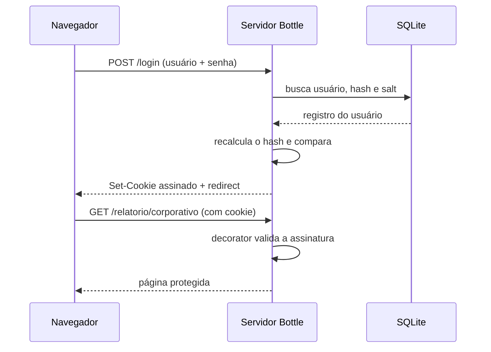

Imagine uma aplicação com uma página de relatórios que só pode ser vista por quem fez login. Basta o usuário digitar `/relatorio/corporativo` na barra de endereços para chegar lá. Como o servidor sabe quem está pedindo a página? E como evitar que alguém simplesmente finja ser outra pessoa?

Neste artigo você vai construir, do zero, uma camada de autenticação para o micro-framework **Bottle**, usando apenas a biblioteca padrão do Python, o SQLite e os recursos nativos do próprio Bottle.

> [!abstract] O que você vai aprender
>
> - Por que o HTTP, sozinho, não "lembra" quem é o usuário
> - Como armazenar senhas de forma segura (salt, PBKDF2 e comparação em tempo constante)
> - Como manter o usuário logado com um cookie assinado
> - Como proteger rotas com um decorator reutilizável
> - Quais ajustes são obrigatórios antes de ir para produção

> [!info] Pré-requisitos
> Python 3.9+, Bottle 0.13 ou superior (`pip install bottle`) e noções básicas de rotas e funções em Python.

---

## 1. O problema: o HTTP não tem memória

O protocolo HTTP é **stateless** (sem estado): cada requisição chega ao servidor isolada, sem nenhuma lembrança das anteriores. Para o servidor, o pedido que você fez há um segundo e o que está fazendo agora são de desconhecidos.

Para "lembrar" de alguém, a aplicação precisa de três mecanismos trabalhando juntos:

| Etapa                       | Pergunta que responde           | Solução neste artigo                             |
| --------------------------- | ------------------------------- | ------------------------------------------------ |
| Identificação e verificação | Quem é você e como provo isso?  | Usuário e senha comparados com um hash no SQLite |
| Persistência da sessão      | Como lembro que você já provou? | Cookie assinado enviado a cada requisição        |
| Controle de acesso          | Quem pode ver esta página?      | Decorator `@requer_autenticacao`                 |

## 2. Visão geral do fluxo

A verificação acontece **antes** de a função da rota (o *callback*) ser executada. Veja o caminho completo de uma requisição:



Em palavras:

1. **Envio das credenciais.** O navegador envia o formulário (`POST /login`). Em produção, isso deve trafegar sempre por HTTPS.
2. **Validação no banco.** O servidor busca o usuário, recupera o *salt* dele, recalcula o hash da senha digitada e compara com o valor guardado.
3. **Emissão do cookie.** Se a senha confere, o servidor devolve um cookie **assinado** com a identidade do usuário.
4. **Interceptação.** Em cada rota restrita, o decorator confere o cookie. Assinatura válida, a requisição segue; inválida ou ausente, o usuário vai para a tela de login.

## 3. Guardando senhas do jeito certo

### Por que não guardar a senha em texto puro?

Se o banco vazar, todas as senhas vazam junto. Algoritmos rápidos como MD5 ou SHA-1 puros também não resolvem: um atacante consegue testar bilhões de combinações por segundo e usar *rainbow tables* (tabelas de hashes pré-calculados) para reverter as senhas mais comuns.

### Os três ingredientes

**Salt.** É um valor aleatório, único por usuário, misturado à senha antes do hash. Com ele, duas pessoas com a mesma senha acabam com hashes completamente diferentes, e as tabelas pré-calculadas deixam de funcionar. O salt **não é secreto**; ele fica no banco ao lado do hash.

**Derivação de chave lenta (PBKDF2).** A biblioteca padrão oferece `hashlib.pbkdf2_hmac`, que repete o cálculo HMAC-SHA256 muitas vezes. Essa lentidão é proposital: para você, custa uma fração de segundo por login; para um atacante testando milhões de senhas, custa uma eternidade.

**Comparação em tempo constante.** Comparar dois textos com `==` termina assim que encontra a primeira diferença. Um atacante pode medir essa variação de tempo (*timing attack*) e deduzir o hash aos poucos. A função `hmac.compare_digest` leva o mesmo tempo independentemente de onde estejam as diferenças.

| Componente         | Função Python         | Configuração recomendada            | Para que serve                                  |
| ------------------ | --------------------- | ----------------------------------- | ----------------------------------------------- |
| Salt               | `os.urandom(16)`      | 16 bytes (128 bits) aleatórios      | Senhas iguais geram hashes diferentes           |
| Derivação de chave | `hashlib.pbkdf2_hmac` | `sha256`, 600.000 iterações ou mais | Encarece ataques de força bruta e de dicionário |
| Comparação         | `hmac.compare_digest` | Tempo constante                     | Impede vazar informação pelo tempo de resposta  |

> [!warning] Atenção ao módulo correto
> A função de comparação em tempo constante está em **`hmac.compare_digest`**, e não em `hashlib`. Escrever `hashlib.compare_digest` gera um `AttributeError`.

> [!tip] Quantas iterações usar?
> O valor de 100.000 iterações, comum em tutoriais antigos, já está defasado. A recomendação atual da OWASP para PBKDF2-HMAC-SHA256 é de **600.000** iterações. Como o hardware evolui, reavalie esse número de tempos em tempos.

### Em código

```python
import hashlib
import hmac
import os

ITERACOES = 600_000

def gerar_hash_senha(senha_plana: str) -> tuple[str, str]:
    """Gera um salt aleatório e devolve a tupla (hash_hex, salt_hex)."""
    salt = os.urandom(16)
    hash_bytes = hashlib.pbkdf2_hmac(
        "sha256", senha_plana.encode("utf-8"), salt, ITERACOES
    )
    return hash_bytes.hex(), salt.hex()

def verificar_senha(senha_digitada: str, hash_salvo: str, salt_salvo: str) -> bool:
    """Recalcula o hash com o salt salvo e compara em tempo constante."""
    hash_calculado = hashlib.pbkdf2_hmac(
        "sha256",
        senha_digitada.encode("utf-8"),
        bytes.fromhex(salt_salvo),
        ITERACOES,
    )
    return hmac.compare_digest(hash_calculado.hex(), hash_salvo)
```

O banco guarda apenas `hash` e `salt` em hexadecimal. A senha original nunca é armazenada.

## 4. Mantendo o usuário logado com cookies assinados

Depois do login, o servidor precisa entregar ao navegador algo que prove "este usuário já se autenticou". O mecanismo natural é um **cookie**. O problema é que cookies comuns podem ser editados à vontade no navegador: bastaria trocar `usuario=joao` por `usuario=admin`.

O Bottle resolve isso com **cookies assinados**. Ao passar o parâmetro `secret` em `response.set_cookie()`, o Bottle anexa ao valor uma assinatura HMAC calculada com uma chave que só o servidor conhece. Na leitura, com `request.get_cookie(..., secret=...)`, ele recalcula a assinatura. Se o cliente alterou qualquer coisa, a validação falha e o retorno é `None`.

> [!note] Assinado não é criptografado
> A assinatura garante **integridade** (ninguém alterou o valor), mas o conteúdo continua legível pelo navegador. Não coloque dados sensíveis no cookie.

Três atributos reforçam a proteção e devem acompanhar o cookie de sessão:

- **`httponly=True`**: bloqueia o acesso ao cookie por JavaScript, o que reduz o estrago de uma falha de XSS (Cross-Site Scripting).
- **`max_age=3600`**: define a validade em segundos (aqui, 1 hora), de modo que sessões esquecidas expiram sozinhas.
- **`samesite="Lax"`** (ou `"Strict"`): restringe o envio do cookie em requisições vindas de outros sites, o que ajuda contra CSRF (Cross-Site Request Forgery). Atenção ao nome do parâmetro: no Bottle é `samesite`, sem sublinhado, e exige a versão 0.13 ou posterior.

Em produção, some a eles o atributo **`secure=True`**, que faz o navegador enviar o cookie apenas por HTTPS.

```python
response.set_cookie(
    "usuario_sessao",
    usuario,
    secret=CHAVE_SECRETA,
    httponly=True,
    max_age=3600,
    samesite="Lax",
    path="/",
    # secure=True,  # ative em produção (HTTPS)
)
```

## 5. Protegendo rotas com um decorator

Você poderia colocar a verificação do cookie no começo de cada rota restrita. Funciona, mas repete código e é fácil esquecer em uma delas. O padrão **Decorator** resolve isso: uma função que "envolve" a rota e executa uma checagem antes de permitir que ela rode.

```python
import functools
from bottle import request, redirect

def requer_autenticacao(funcao_rota):
    @functools.wraps(funcao_rota)
    def wrapper(*args, **kwargs):
        usuario = request.get_cookie("usuario_sessao", secret=CHAVE_SECRETA)
        if not usuario:
            redirect("/login?erro=restrito")
        return funcao_rota(*args, **kwargs)
    return wrapper
```

O que acontece aqui:

- `request.get_cookie(..., secret=...)` devolve o valor se a assinatura for válida e `None` caso contrário.
- `redirect()` interrompe a execução e envia o usuário para o login. Por isso o `return` da rota nunca é alcançado para quem não está autenticado.
- `@functools.wraps` preserva o nome, a docstring e a assinatura da função original. Sem ele, todas as rotas decoradas passariam a se chamar `wrapper`, o que causa confusão no registro interno do Bottle.

Para proteger uma rota, basta empilhar o decorator **abaixo** do decorator de rota:

```python
@app.get("/relatorio/corporativo")
@requer_autenticacao
def relatorio():
    ...
```

## 6. A aplicação completa

Juntando as peças, este é o servidor completo. Salve como `app.py`.

```python
import functools
import hashlib
import hmac
import html
import os
import sqlite3
from pathlib import Path

from bottle import Bottle, request, response, redirect, template, run

app = Bottle()

DB_PATH = Path(__file__).parent / "meu_banco_de_dados.db"
# Em produção, defina a variável de ambiente CHAVE_SECRETA (valor longo e aleatório)
CHAVE_SECRETA = os.environ.get("CHAVE_SECRETA", "somente-para-desenvolvimento")
ITERACOES = 600_000
MODO_DEBUG = os.environ.get("DEBUG") == "1"

# Mensagens fixas: a URL carrega só um código, nunca texto livre
MENSAGENS = {
    "campos": "Preencha todos os campos.",
    "credenciais": "Usuário ou senha inválidos.",
    "restrito": "Acesso restrito. Faça login para continuar.",
    "saiu": "Sessão encerrada com sucesso.",
}

# Salt descartável, usado para gastar o mesmo tempo quando o usuário não existe
SALT_FALSO = os.urandom(16)


# ------------------------------------------------------------------
# 1. SEGURANÇA: HASH E VERIFICAÇÃO DE SENHAS
# ------------------------------------------------------------------
def gerar_hash_senha(senha_plana: str) -> tuple[str, str]:
    salt = os.urandom(16)
    hash_bytes = hashlib.pbkdf2_hmac(
        "sha256", senha_plana.encode("utf-8"), salt, ITERACOES
    )
    return hash_bytes.hex(), salt.hex()


def verificar_senha(senha_digitada: str, hash_salvo: str, salt_salvo: str) -> bool:
    hash_calculado = hashlib.pbkdf2_hmac(
        "sha256",
        senha_digitada.encode("utf-8"),
        bytes.fromhex(salt_salvo),
        ITERACOES,
    )
    return hmac.compare_digest(hash_calculado.hex(), hash_salvo)


# ------------------------------------------------------------------
# 2. BANCO DE DADOS SQLITE
# ------------------------------------------------------------------
def get_connection() -> sqlite3.Connection:
    conn = sqlite3.connect(DB_PATH)
    conn.row_factory = sqlite3.Row
    return conn


def inicializar_banco() -> None:
    """Cria a tabela e um usuário de teste ('admin') se ele não existir."""
    with get_connection() as conn:
        conn.execute(
            """
            CREATE TABLE IF NOT EXISTS usuarios (
                id INTEGER PRIMARY KEY AUTOINCREMENT,
                usuario TEXT NOT NULL UNIQUE,
                senha_hash TEXT NOT NULL,
                salt TEXT NOT NULL
            );
            """
        )
        existe = conn.execute(
            "SELECT id FROM usuarios WHERE usuario = ?;", ("admin",)
        ).fetchone()
        if not existe:
            senha_hash, salt = gerar_hash_senha("senha123")
            conn.execute(
                "INSERT INTO usuarios (usuario, senha_hash, salt) VALUES (?, ?, ?);",
                ("admin", senha_hash, salt),
            )


# ------------------------------------------------------------------
# 3. DECORATOR DE AUTENTICAÇÃO
# ------------------------------------------------------------------
def requer_autenticacao(funcao_rota):
    @functools.wraps(funcao_rota)
    def wrapper(*args, **kwargs):
        usuario = request.get_cookie("usuario_sessao", secret=CHAVE_SECRETA)
        if not usuario:
            redirect("/login?erro=restrito")
        return funcao_rota(*args, **kwargs)

    return wrapper


# ------------------------------------------------------------------
# 4. LOGIN E LOGOUT
# ------------------------------------------------------------------
TPL_LOGIN = """
<!DOCTYPE html>
<html lang="pt-br">
<head>
    <meta charset="UTF-8">
    <title>Acesso ao Sistema</title>
    <style>
        body { font-family: 'Segoe UI', sans-serif; display: flex; justify-content: center;
               align-items: center; height: 100vh; background: #f4f6f9; margin: 0; }
        .card { background: white; padding: 30px; border-radius: 8px;
                box-shadow: 0 4px 12px rgba(0,0,0,0.1); width: 320px; }
        label { display: block; margin-top: 12px; color: #666; font-size: 0.9em; }
        input[type="text"], input[type="password"] { width: 100%; padding: 10px; margin-top: 5px;
               box-sizing: border-box; border: 1px solid #ccc; border-radius: 4px; }
        input[type="submit"] { width: 100%; background: #0d6efd; color: white; border: none;
               padding: 10px; margin-top: 20px; font-weight: bold; border-radius: 4px; cursor: pointer; }
        .alerta { background: #f8d7da; color: #721c24; padding: 8px; border-radius: 4px;
               font-size: 0.85em; margin-bottom: 10px; }
    </style>
</head>
<body>
    <div class="card">
        <h2>🔐 Autenticação</h2>
        % if msg_erro:
            <div class="alerta">⚠️ {{ msg_erro }}</div>
        % end
        <form action="/login" method="post">
            <label>Usuário:</label>
            <input type="text" name="usuario" required>
            <label>Senha:</label>
            <input type="password" name="senha" required>
            <input type="submit" value="Entrar no Sistema">
        </form>
    </div>
</body>
</html>
"""


@app.get("/login")
def exibir_login():
    msg_erro = MENSAGENS.get(request.query.get("erro", ""), "")
    return template(TPL_LOGIN, msg_erro=msg_erro)


@app.post("/login")
def processar_login():
    usuario_input = (request.forms.getunicode("usuario") or "").strip()
    senha_input = request.forms.getunicode("senha") or ""  # não use strip() em senhas

    if not usuario_input or not senha_input:
        redirect("/login?erro=campos")

    with get_connection() as conn:
        registro = conn.execute(
            "SELECT usuario, senha_hash, salt FROM usuarios WHERE usuario = ?;",
            (usuario_input,),
        ).fetchone()

    if registro:
        senha_ok = verificar_senha(
            senha_input, registro["senha_hash"], registro["salt"]
        )
    else:
        # Gasta o mesmo tempo de CPU para não revelar que o usuário não existe
        hashlib.pbkdf2_hmac(
            "sha256", senha_input.encode("utf-8"), SALT_FALSO, ITERACOES
        )
        senha_ok = False

    if not senha_ok:
        redirect("/login?erro=credenciais")

    response.set_cookie(
        "usuario_sessao",
        registro["usuario"],
        secret=CHAVE_SECRETA,
        httponly=True,
        max_age=3600,
        samesite="Lax",
        path="/",
        # secure=True,  # ative em produção (HTTPS)
    )
    redirect("/relatorio/corporativo")


@app.post("/logout")
def logout():
    response.delete_cookie("usuario_sessao", path="/")
    redirect("/login?erro=saiu")


# ------------------------------------------------------------------
# 5. ROTA PROTEGIDA
# ------------------------------------------------------------------
@app.get("/relatorio/corporativo")
@requer_autenticacao
def exibir_relatorio():
    usuario = request.get_cookie("usuario_sessao", secret=CHAVE_SECRETA)
    usuario_seguro = html.escape(usuario)  # evita injeção de HTML (XSS)
    return f"""
        <!DOCTYPE html>
        <html lang="pt-br">
        <head><meta charset="UTF-8"><title>Relatório Protegido</title></head>
        <body style="font-family: sans-serif; padding: 30px;">
            <h1>📊 Painel Restrito de Relatórios</h1>
            <p>Sessão ativa para: <strong>{usuario_seguro}</strong></p>
            <form action="/logout" method="post">
                <button type="submit">Encerrar sessão</button>
            </form>
            <hr>
            <p>✅ Conteúdo liberado após verificação do cookie assinado.</p>
        </body>
        </html>
    """


if __name__ == "__main__":
    inicializar_banco()
    print("Servidor ativo em http://localhost:8080")
    run(app, host="localhost", port=8080, debug=MODO_DEBUG, reloader=MODO_DEBUG)
```

### Como testar

```bash
pip install bottle
DEBUG=1 python app.py
```

1. Acesse `http://localhost:8080/relatorio/corporativo` sem estar logado: você deve ser redirecionado para o login.
2. Entre com `admin` / `senha123`: o relatório deve aparecer.
3. Abra as ferramentas do navegador, edite o valor do cookie `usuario_sessao` e recarregue: a assinatura falha e você volta ao login.
4. Clique em **Encerrar sessão** e tente voltar ao relatório.

> [!danger] Credenciais de teste
> O usuário `admin` com a senha `senha123` existe **apenas** para fins didáticos. Nunca publique uma aplicação com credenciais padrão.

## 7. O que mudou em relação a um exemplo "ingênuo"

Pequenos detalhes separam um exemplo de estudo de um código minimamente seguro. Os principais ajustes feitos acima:

| Ponto                     | Problema comum                                           | O que o código faz                                      |
| ------------------------- | -------------------------------------------------------- | ------------------------------------------------------- |
| Comparação de hashes      | `hashlib.compare_digest` não existe                      | Usa `hmac.compare_digest`                               |
| Usuário inexistente       | Resposta mais rápida revela quais usuários existem       | Calcula um hash descartável para igualar o tempo        |
| Senha digitada            | `.strip()` altera a senha original                       | Só o nome de usuário passa por `strip()`                |
| Mensagem de erro na URL   | Texto livre na query string permite mensagens forjadas   | A URL leva um código; o texto vem de um dicionário fixo |
| Nome do usuário na página | Inserir direto no HTML permite XSS                       | `html.escape()` antes de exibir                         |
| Logout                    | Via GET, qualquer página externa pode deslogar o usuário | Via POST, com botão em formulário                       |
| Chave secreta             | Escrita no código-fonte                                  | Lida de variável de ambiente                            |

## 8. Antes de ir para produção

> [!warning] Checklist mínimo
>
> 1. **Segredo fora do código.** Defina `CHAVE_SECRETA` por variável de ambiente (ou em um cofre de segredos) com um valor longo e aleatório. Quem conhece a chave consegue forjar cookies válidos.
> 2. **HTTPS obrigatório.** Ative `secure=True` no cookie e coloque a aplicação atrás de um servidor com TLS.
> 3. **Modo de depuração desligado.** Com `debug=True`, falhas exibem *stack traces* completos para o cliente, expondo detalhes internos. O código acima só ativa debug e *reloader* quando `DEBUG=1`.
> 4. **Servidor de produção.** O servidor embutido do Bottle é para desenvolvimento. Use Gunicorn, Waitress ou similar.

## 9. Limitações e próximos passos

Esta solução é ótima para aprender e para aplicações pequenas, mas tem limites que vale conhecer:

- **O cookie não pode ser revogado.** O logout apenas apaga o cookie no navegador; uma cópia dele continua válida até expirar (`max_age`). Para invalidar sessões de verdade, guarde-as **no servidor** (uma tabela `sessoes` com um identificador aleatório) e coloque só esse identificador no cookie.
- **O Bottle serializa o cookie assinado com `pickle`.** Isso é seguro enquanto a chave secreta permanecer secreta, mas reforça o porquê de protegê-la com rigor.
- **Não há limite de tentativas de login.** Considere bloquear ou atrasar logins após várias falhas seguidas, para dificultar ataques de força bruta.
- **Não há cadastro de usuários.** Para criar contas novas, reutilize `gerar_hash_senha()` em uma rota de registro.
- **Proteção CSRF completa.** `SameSite` ajuda, mas formulários que alteram dados também devem usar tokens CSRF.
- **Atualização do custo do hash.** Guardar o número de iterações em uma coluna do banco permite aumentá-lo no futuro sem invalidar senhas antigas.

## Resumo

- O HTTP não guarda estado, então a identidade precisa viajar a cada requisição.
- Senhas são armazenadas com **salt** aleatório e **PBKDF2** com muitas iterações, e comparadas em **tempo constante** com `hmac.compare_digest`.
- O **cookie assinado** impede adulteração, e `httponly`, `max_age` e `samesite` reduzem a superfície de ataque.
- O **decorator** `@requer_autenticacao` centraliza a proteção e mantém as rotas limpas.
- Segredo no ambiente, HTTPS e debug desligado são requisitos para produção.
