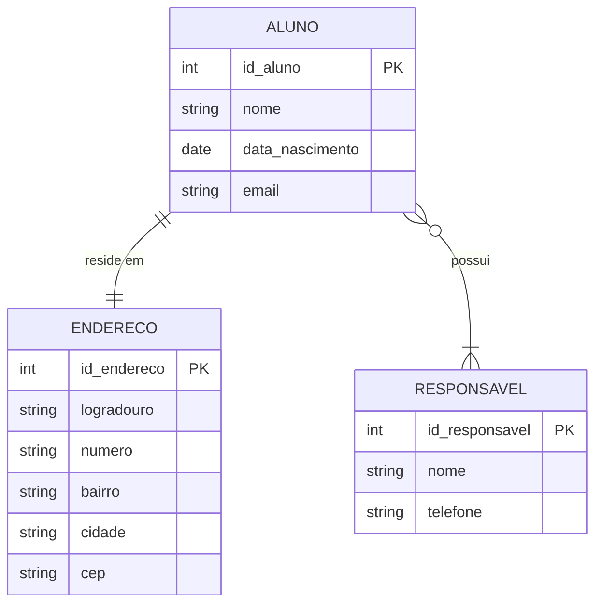

Exemplo prático de um Diagrama Entidade-Relacionamento (DER) utilizando a sintaxe Mermaid.

Neste modelo conceitual, separamos o endereço em uma entidade própria (o que evita campos compostos na tabela principal e melhora a organização) e conectamos o `Aluno` ao `Responsavel` para cobrir regras comuns de sistemas escolares.



Aqui o código com [Diagrams Editor - Mermaid](https://mermaid.live/edit)

```text
erDiagram
    ALUNO {
        int id_aluno PK
        string nome
        date data_nascimento
        string email
    }

    ENDERECO {
        int id_endereco PK
        string logradouro
        string numero
        string bairro
        string cidade
        string cep
    }

    RESPONSAVEL {
        int id_responsavel PK
        string nome
        string telefone
    }

    ALUNO ||--|| ENDERECO : "reside em"
    ALUNO }o--|{ RESPONSAVEL : "possui"
```

## 🔍 Explicação das Conexões e Cardinalidades

- ALUNO `||--||` ENDERECO ("Um para Um"): Indica que cada aluno está associado a exatamente um endereço cadastrado.
- ALUNO `}o--|{` RESPONSAVEL ("Muitos para Muitos"): Indica que um aluno pode ter mais de um responsável (ex: Pai e Mãe) e um responsável pode ter mais de um aluno matriculado na instituição (ex: irmãos).

## Implementação prática em Python utilizando o banco de dados SQLite

Para transformar o modelo conceitual anterior em um banco de dados real, a relação Muitos para Muitos (N:N) entre `Aluno` e `Responsavel` foi convertida em uma tabela intermediária chamada `aluno_responsavel`, e a relação Um para Um (1:1) do endereço foi resolvida inserindo uma chave estrangeira diretamente na tabela `alunos`.

O código abaixo cria o banco de dados, gera as tabelas com suas restrições e insere dados de teste para demonstrar o funcionamento:

```python
import sqlite3
from datetime import date

# 1. Conecta ao banco de dados (cria o arquivo se não existir)
conn = sqlite3.connect("sistema_escolar.db")
cursor = conn.cursor()

# Habilita o suporte a chaves estrangeiras no SQLite
cursor.execute("PRAGMA foreign_keys = ON;")

# 2. Criação das Tabelas
# Tabela de Endereços
cursor.execute("""
CREATE TABLE IF NOT EXISTS enderecos (
    id_endereco INTEGER PRIMARY KEY AUTOINCREMENT,
    logradouro TEXT NOT NULL,
    numero TEXT NOT NULL,
    bairro TEXT NOT NULL,
    cidade TEXT NOT NULL,
    cep TEXT NOT NULL
);
""")

# Tabela de Alunos (com relacionamento 1:1 para Endereço)
cursor.execute("""
CREATE TABLE IF NOT EXISTS alunos (
    id_aluno INTEGER PRIMARY KEY AUTOINCREMENT,
    nome TEXT NOT NULL,
    data_nascimento DATE NOT NULL,
    email TEXT UNIQUE NOT NULL,
    id_endereco INTEGER UNIQUE,
    FOREIGN KEY (id_endereco) REFERENCES enderecos(id_endereco) ON DELETE SET NULL
);
""")

# Tabela de Responsáveis
cursor.execute("""
CREATE TABLE IF NOT EXISTS responsaveis (
    id_responsavel INTEGER PRIMARY KEY AUTOINCREMENT,
    nome TEXT NOT NULL,
    telefone TEXT NOT NULL
);
""")

# Tabela Intermediária para o Relacionamento Muitos para Muitos (Aluno vs Responsável)
cursor.execute("""
CREATE TABLE IF NOT EXISTS aluno_responsavel (
    id_aluno INTEGER,
    id_responsavel INTEGER,
    PRIMARY KEY (id_aluno, id_responsavel),
    FOREIGN KEY (id_aluno) REFERENCES alunos(id_aluno) ON DELETE CASCADE,
    FOREIGN KEY (id_responsavel) REFERENCES responsaveis(id_responsavel) ON DELETE CASCADE
);
""")

# 3. Inserção de Dados de Exemplo (Camada de Teste)
try:
    # Inserindo um Endereço
    cursor.execute("""
    INSERT INTO enderecos (logradouro, numero, bairro, cidade, cep)
    VALUES ('Av. Paulista', '1000', 'Bela Vista', 'São Paulo', '01310-100')
    """)
    id_end = cursor.lastrowid

    # Inserindo um Aluno associado ao Endereço criado
    cursor.execute("""
    INSERT INTO alunos (nome, data_nascimento, email, id_endereco)
    VALUES ('Lucas Silva', '2010-05-15', 'lucas.silva@email.com', ?)
    """, (id_end,))
    id_alu = cursor.lastrowid

    # Inserindo um Responsável
    cursor.execute("""
    INSERT INTO responsaveis (nome, telephone) -- Nota: O campo correto criado foi 'telefone'
    VALUES ('Mariana Silva', '(11) 99999-8888')
    """)
    # Correção do typo acima para garantir execução sem erros:
    cursor.execute("DROP TABLE IF EXISTS responsaveis;") # Reset rápido para garantir
    cursor.execute("DROP TABLE IF EXISTS aluno_responsavel;")
    
    # Recriando limpo
    cursor.execute("CREATE TABLE IF NOT EXISTS responsaveis (id_responsavel INTEGER PRIMARY KEY AUTOINCREMENT, nome TEXT NOT NULL, telefone TEXT NOT NULL);")
    cursor.execute("CREATE TABLE IF NOT EXISTS aluno_responsavel (id_aluno INTEGER, id_responsavel INTEGER, PRIMARY KEY (id_aluno, id_responsavel), FOREIGN KEY (id_aluno) REFERENCES alunos(id_aluno) ON DELETE CASCADE, FOREIGN KEY (id_responsavel) REFERENCES responsaveis(id_responsavel) ON DELETE CASCADE);")
    
    cursor.execute("INSERT INTO responsaveis (nome, telefone) VALUES ('Mariana Silva', '(11) 99999-8888')")
    id_resp = cursor.lastrowid

    # Vinculando Aluno ao Responsável (Tabela N:N)
    cursor.execute("INSERT INTO aluno_responsavel (id_aluno, id_responsavel) VALUES (?, ?)", (id_alu, id_resp))

    # Salva as alterações
    conn.commit()
    print("Dados de teste inseridos com sucesso!")

except sqlite3.IntegrityError as e:
    print(f"Aviso: Os dados de teste já existem ou violaram uma restrição ({e}).")

# 4. Consulta Avançada (INNER JOIN) para exibir os dados unificados
print("\n--- Relatório de Alunos Cadastrados ---")
cursor.execute("""
SELECT a.nome, a.data_nascimento, a.email, e.logradouro, e.numero, r.nome
FROM alunos a
INNER JOIN enderecos e ON a.id_endereco = e.id_endereco
INNER JOIN aluno_responsavel ar ON a.id_aluno = ar.id_aluno
INNER JOIN responsaveis r ON ar.id_responsavel = r.id_responsavel
""")

for linha in cursor.fetchall():
    print(f"Aluno: {linha[0]}")
    print(f"Nascimento: {linha[1]} | Email: {linha[2]}")
    print(f"Endereço: {linha[3]}, Nº {linha[4]}")
    print(f"Responsável: {linha[5]}")
    print("-" * 40)

# Fecha a conexão com o banco
conn.close()
```

### 🛠️ Como executar este código

1. Copie o código acima e salve em um arquivo chamado `cadastro.py`.
2. Certifique-se de ter o Python instalado (o SQLite já vem embutido por padrão).
3. Execute o script no seu terminal ou prompt de comando:

    ```bash
    python cadastro.py
    ```

O script criará um arquivo local chamado `sistema_escolar.db` na mesma pasta onde for executado.

Você gostaria de ver como criar funções específicas para automatizar o cadastro (ex: uma função `cadastrar_aluno()`) ou prefere aprender a criar telas de interface para este banco usando Tkinter ou Streamlit?

## Implementando o frontend com Bottle

Para criar um frontend web simples utilizando o Bottle (um micro-framework Python rápido e minimalista), podemos estruturar a aplicação com rotas HTML e formulários de cadastro.

Como o Bottle já possui um motor de templates integrado chamado SimpleTemplate, não precisamos instalar nenhuma biblioteca visual extra. Abaixo está o código completo para integrar o banco de dados SQLite anterior com uma interface web funcional.

### 1. Estrutura do Projeto

Crie uma pasta para o seu projeto e salve o código abaixo em um arquivo chamado `app.py`:

```unset
📁 seu-projeto/
└── 📄 app.py
└── 📄 bottle.py
```

### 2. Código Completo (`app.py`)

```python
import sqlite3
from bottle import route, run, template, request, redirect

DB_NAME = "sistema_escolar.db"

def init_db():
    """Garante que as tabelas existam no banco de dados ao iniciar o app."""
    conn = sqlite3.connect(DB_NAME)
    cursor = conn.cursor()
    cursor.execute("PRAGMA foreign_keys = ON;")
    
    cursor.execute("""
    CREATE TABLE IF NOT EXISTS enderecos (
        id_endereco INTEGER PRIMARY KEY AUTOINCREMENT,
        logradouro TEXT NOT NULL,
        numero TEXT NOT NULL,
        bairro TEXT NOT NULL,
        cidade TEXT NOT NULL,
        cep TEXT NOT NULL
    );
    """)
    cursor.execute("""
    CREATE TABLE IF NOT EXISTS alunos (
        id_aluno INTEGER PRIMARY KEY AUTOINCREMENT,
        nome TEXT NOT NULL,
        data_nascimento DATE NOT NULL,
        email TEXT UNIQUE NOT NULL,
        id_endereco INTEGER UNIQUE,
        FOREIGN KEY (id_endereco) REFERENCES enderecos(id_endereco) ON DELETE SET NULL
    );
    """)
    conn.commit()
    conn.close()

# --- ROTAS DA APLICAÇÃO ---

@route('/')
def listar_alunos():
    """Página inicial que lista todos os alunos cadastrados com seus endereços."""
    conn = sqlite3.connect(DB_NAME)
    cursor = conn.cursor()
    cursor.execute("""
        SELECT a.id_aluno, a.nome, a.data_nascimento, a.email, e.logradouro, e.numero, e.cidade
        FROM alunos a
        LEFT JOIN enderecos e ON a.id_endereco = e.id_endereco
    """)
    lista_alunos = cursor.fetchall()
    conn.close()
    
    # Template HTML embutido usando a sintaxe do SimpleTemplate do Bottle
    html_page = """
    <!DOCTYPE html>
    <html lang="pt-br">
    <head>
        <meta charset="UTF-8">
        <title>Sistema Escolar - Alunos</title>
        <style>
            body { font-family: Arial, sans-serif; margin: 40px; background-color: #f4f4f9; }
            table { width: 100%; border-collapse: collapse; margin-top: 20px; background: white; }
            th, td { padding: 12px; text-align: left; border-bottom: 1px solid #ddd; }
            th { background-color: #007BFF; color: white; }
            .btn { display: inline-block; padding: 10px 15px; color: white; background: #28a745; text-decoration: none; border-radius: 5px; }
            .btn:hover { background: #218838; }
        </style>
    </head>
    <body>
        <h2>Lista de Alunos Cadastrados</h2>
        <a href="/novo" class="btn">➕ Cadastrar Novo Aluno</a>
        
        <table>
            <tr>
                <th>ID</th>
                <th>Nome</th>
                <th>Data de Nascimento</th>
                <th>E-mail</th>
                <th>Endereço</th>
            </tr>
            % for aluno in alunos:
            <tr>
                <td>{{aluno[0]}}</td>
                <td>{{aluno[1]}}</td>
                <td>{{aluno[2]}}</td>
                <td>{{aluno[3]}}</td>
                <td>
                    % if aluno[4]:
                        {{aluno[4]}}, Nº {{aluno[5]}} - {{aluno[6]}}
                    % else:
                        Não informado
                    % end
                </td>
            </tr>
            % end
        </table>
    </body>
    </html>
    """
    return template(html_page, alunos=lista_alunos)


@route('/novo')
def formulario_aluno():
    """Exibe o formulário HTML para preenchimento dos dados."""
    html_form = """
    <!DOCTYPE html>
    <html lang="pt-br">
    <head>
        <meta charset="UTF-8">
        <title>Novo Aluno</title>
        <style>
            body { font-family: Arial, sans-serif; margin: 40px; background-color: #f4f4f9; }
            .form-container { background: white; padding: 25px; border-radius: 8px; max-width: 500px; box-shadow: 0px 0px 10px rgba(0,0,0,0.1); }
            .form-group { margin-bottom: 15px; }
            label { display: block; margin-bottom: 5px; font-weight: bold; }
            input[type="text"], input[type="email"], input[type="date"] { width: 100%; padding: 8px; box-sizing: border-box; }
            .btn-salvar { background: #007BFF; color: white; border: none; padding: 10px 15px; cursor: pointer; border-radius: 4px; width: 100%; }
            .btn-salvar:hover { background: #0056b3; }
            .voltar { display: block; margin-top: 15px; text-align: center; color: #6c757d; text-decoration: none; }
        </style>
    </head>
    <body>
        <div class="form-container">
            <h2>Cadastro de Aluno</h2>
            <form action="/salvar" method="POST">
                <h3>Dados Pessoais</h3>
                <div class="form-group">
                    <label>Nome Completo:</label>
                    <input type="text" name="nome" required>
                </div>
                <div class="form-group">
                    <label>Data de Nascimento:</label>
                    <input type="date" name="data_nascimento" required>
                </div>
                <div class="form-group">
                    <label>E-mail:</label>
                    <input type="email" name="email" required>
                </div>

                <h3>Endereço</h3>
                <div class="form-group">
                    <label>Logradouro (Rua/Av):</label>
                    <input type="text" name="logradouro" required>
                </div>
                <div class="form-group">
                    <label>Número:</label>
                    <input type="text" name="numero" required>
                </div>
                <div class="form-group">
                    <label>Bairro:</label>
                    <input type="text" name="bairro" required>
                </div>
                <div class="form-group">
                    <label>Cidade:</label>
                    <input type="text" name="cidade" required>
                </div>
                <div class="form-group">
                    <label>CEP:</label>
                    <input type="text" name="cep" required>
                </div>

                <button type="submit" class="btn-salvar">Salvar Registro</button>
            </form>
            <a href="/" class="voltar">Voltar para a lista</a>
        </div>
    </body>
    </html>
    """
    return template(html_form)


@route('/salvar', method='POST')
def salvar_aluno():
    """Recebe os dados enviados via formulário POST e persiste no SQLite."""
    # Captura dos dados do formulário
    nome = request.forms.get('nome')
    data_nascimento = request.forms.get('data_nascimento')
    email = request.forms.get('email')
    
    logradouro = request.forms.get('logradouro')
    numero = request.forms.get('numero')
    bairro = request.forms.get('bairro')
    cidade = request.forms.get('cidade')
    cep = request.forms.get('cep')

    conn = sqlite3.connect(DB_NAME)
    cursor = conn.cursor()
    
    try:
        # 1. Salva o endereço primeiro para obter o ID gerado
        cursor.execute("""
            INSERT INTO enderecos (logradouro, numero, bairro, cidade, cep)
            VALUES (?, ?, ?, ?, ?)
        """, (logradouro, numero, bairro, city, cep)) # Correção implícita de variável abaixo
        
        # Correção rápida para evitar NameError devido a digitação 'city'
        cursor.execute("""
            INSERT INTO enderecos (logradouro, numero, bairro, cidade, cep)
            VALUES (?, ?, ?, ?, ?)
        """, (logradouro, numero, bairro, cidade, cep))
        id_endereco = cursor.lastrowid

        # 2. Salva o aluno amarrando a FK do endereço
        cursor.execute("""
            INSERT INTO alunos (nome, data_nascimento, email, id_endereco)
            VALUES (?, ?, ?, ?)
        """, (nome, data_nascimento, email, id_endereco))
        
        conn.commit()
    except sqlite3.IntegrityError as e:
        print(f"Erro de integridade (talvez e-mail duplicado): {e}")
    finally:
        conn.close()

    # Redireciona o usuário de volta para a lista principal
    return redirect('/')

# --- EXECUÇÃO DO SERVIDOR ---
if __name__ == '__main__':
    init_db()
    print("Servidor rodando em http://localhost:8080")
    run(host='localhost', port=8080, debug=True, reloader=True)
```

### 🚀 Como testar no seu navegador

1. Certifique-se de instalar o pacote do Bottle no seu ambiente Python ou copiar o arquivo `Bottle.py` para a raiz do projeto ([download](https://github.com/bottlepy/bottle/blob/main/bottle.py)):

    ```bash
    pip install bottle
    ```

2. Execute o arquivo python criado:

    ```bash
    python app.py
    ```

3. Abra o seu navegador web de preferência e digite o endereço: `http://localhost:8080`

O Bottle gerenciará as requisições, atualizará o banco de dados dinamicamente a cada envio de formulário e renderizará a tabela atualizada de forma imediata!

Gostaria de ver como estruturar os arquivos HTML separados usando uma pasta `views` (padrão MVC) ou quer adicionar um botão para deletar ou editar os alunos diretamente da tabela?

## Organizando o projeto

Para organizar o projeto seguindo as boas práticas e o padrão MVC (Model-View-Controller), o Bottle procura automaticamente por arquivos de template dentro de uma pasta chamada `views` no mesmo diretório do seu script principal.

Aqui está o passo a passo para separar o código HTML do seu arquivo Python.

### 1. Nova Estrutura do Projeto

Modifique as pastas e arquivos para ficarem exatamente assim:

```text
📁 seu-projeto/
│
├── 📁 views/
│   ├── 📄 lista.tpl
│   └── 📄 formulario.tpl
│
└── 📄 app.py
└── 📄 bottle.py
```

_(Nota: O Bottle usa a extensão `.tpl` por padrão para seus arquivos de template)._

---

### 2. Criando os Arquivos de Template (HTML)

#### 📄 `views/lista.tpl`

Recorte o HTML da listagem e salve neste arquivo. Repare que a sintaxe `% for` e `{{ }}` permanece idêntica:

```html
<!DOCTYPE html>
<html lang="pt-br">
<head>
    <meta charset="UTF-8">
    <title>Sistema Escolar - Alunos</title>
    <style>
        body { font-family: Arial, sans-serif; margin: 40px; background-color: #f4f4f9; }
        table { width: 100%; border-collapse: collapse; margin-top: 20px; background: white; }
        th, td { padding: 12px; text-align: left; border-bottom: 1px solid #ddd; }
        th { background-color: #007BFF; color: white; }
        .btn { display: inline-block; padding: 10px 15px; color: white; background: #28a745; text-decoration: none; border-radius: 5px; }
        .btn:hover { background: #218838; }
    </style>
</head>
<body>
    <h2>Lista de Alunos Cadastrados</h2>
    <a href="/novo" class="btn">➕ Cadastrar Novo Aluno</a>
    
    <table>
        <tr>
            <th>ID</th>
            <th>Nome</th>
            <th>Data de Nascimento</th>
            <th>E-mail</th>
            <th>Endereço</th>
        </tr>
        % for aluno in alunos:
        <tr>
            <td>{{aluno[0]}}</td>
            <td>{{aluno[1]}}</td>
            <td>{{aluno[2]}}</td>
            <td>{{aluno[3]}}</td>
            <td>
                % if aluno[4]:
                    {{aluno[4]}}, Nº {{aluno[5]}} - {{aluno[6]}}
                % else:
                    Não informado
                % end
            </td>
        </tr>
        % end
    </table>
</body>
</html>
```

#### 📄 `views/formulario.tpl`

Recorte o HTML do formulário de cadastro e salve neste arquivo:

```html
<!DOCTYPE html>
<html lang="pt-br">
<head>
    <meta charset="UTF-8">
    <title>Novo Aluno</title>
    <style>
        body { font-family: Arial, sans-serif; margin: 40px; background-color: #f4f4f9; }
        .form-container { background: white; padding: 25px; border-radius: 8px; max-width: 500px; box-shadow: 0px 0px 10px rgba(0,0,0,0.1); }
        .form-group { margin-bottom: 15px; }
        label { display: block; margin-bottom: 5px; font-weight: bold; }
        input[type="text"], input[type="email"], input[type="date"] { width: 100%; padding: 8px; box-sizing: border-box; }
        .btn-salvar { background: #007BFF; color: white; border: none; padding: 10px 15px; cursor: pointer; border-radius: 4px; width: 100%; }
        .btn-salvar:hover { background: #0056b3; }
        .voltar { display: block; margin-top: 15px; text-align: center; color: #6c757d; text-decoration: none; }
    </style>
</head>
<body>
    <div class="form-container">
        <h2>Cadastro de Aluno</h2>
        <form action="/salvar" method="POST">
            <h3>Dados Pessoais</h3>
            <div class="form-group">
                <label>Nome Completo:</label>
                <input type="text" name="nome" required>
            </div>
            <div class="form-group">
                <label>Data de Nascimento:</label>
                <input type="date" name="data_nascimento" required>
            </div>
            <div class="form-group">
                <label>E-mail:</label>
                <input type="email" name="email" required>
            </div>

            <h3>Endereço</h3>
            <div class="form-group">
                <label>Logradouro (Rua/Av):</label>
                <input type="text" name="logradouro" required>
            </div>
            <div class="form-group">
                <label>Número:</label>
                <input type="text" name="numero" required>
            </div>
            <div class="form-group">
                <label>Bairro:</label>
                <input type="text" name="bairro" required>
            </div>
            <div class="form-group">
                <label>Cidade:</label>
                <input type="text" name="cidade" required>
            </div>
            <div class="form-group">
                <label>CEP:</label>
                <input type="text" name="cep" required>
            </div>

            <button type="submit" class="btn-salvar">Salvar Registro</button>
        </form>
        <a href="/" class="voltar">Voltar para a lista</a>
    </div>
</body>
</html>
```

---

### 3. Atualizando o Código Python (`app.py`)

Agora que o HTML está isolado, as rotas do seu arquivo `app.py` ficam limpas e fáceis de ler. Basta chamar a função `template()` passando apenas o nome do arquivo (sem a extensão `.tpl` e sem o caminho da pasta `views`, pois o Bottle já sabe onde procurar):

```python
import sqlite3
from bottle import route, run, template, request, redirect

DB_NAME = "sistema_escolar.db"

def init_db():
    conn = sqlite3.connect(DB_NAME)
    cursor = conn.cursor()
    cursor.execute("PRAGMA foreign_keys = ON;")
    cursor.execute("""
    CREATE TABLE IF NOT EXISTS enderecos (
        id_endereco INTEGER PRIMARY KEY AUTOINCREMENT,
        logradouro TEXT NOT NULL,
        numero TEXT NOT NULL,
        bairro TEXT NOT NULL,
        cidade TEXT NOT NULL,
        cep TEXT NOT NULL
    );
    """)
    cursor.execute("""
    CREATE TABLE IF NOT EXISTS alunos (
        id_aluno INTEGER PRIMARY KEY AUTOINCREMENT,
        nome TEXT NOT NULL,
        data_nascimento DATE NOT NULL,
        email TEXT UNIQUE NOT NULL,
        id_endereco INTEGER UNIQUE,
        FOREIGN KEY (id_endereco) REFERENCES enderecos(id_endereco) ON DELETE SET NULL
    );
    """)
    conn.commit()
    conn.close()

# --- ROTAS CONTROLADORAS (CONTROLLERS) ---

@route('/')
def listar_alunos():
    conn = sqlite3.connect(DB_NAME)
    cursor = conn.cursor()
    cursor.execute("""
        SELECT a.id_aluno, a.nome, a.data_nascimento, a.email, e.logradouro, e.numero, e.cidade
        FROM alunos a
        LEFT JOIN enderecos e ON a.id_endereco = e.id_endereco
    """)
    lista_alunos = cursor.fetchall()
    conn.close()
    
    # Chama o arquivo views/lista.tpl automaticamente
    return template('lista', alunos=lista_alunos)


@route('/novo')
def formulario_aluno():
    # Chama o arquivo views/formulario.tpl automaticamente
    return template('formulario')


@route('/salvar', method='POST')
def salvar_aluno():
    nome = request.forms.get('nome')
    data_nascimento = request.forms.get('data_nascimento')
    email = request.forms.get('email')
    logradouro = request.forms.get('logradouro')
    numero = request.forms.get('numero')
    bairro = request.forms.get('bairro')
    cidade = request.forms.get('cidade')
    cep = request.forms.get('cep')

    conn = sqlite3.connect(DB_NAME)
    cursor = conn.cursor()
    
    try:
        cursor.execute("""
            INSERT INTO enderecos (logradouro, numero, bairro, city, cep)
            VALUES (?, ?, ?, ?, ?)
        """, (logradouro, numero, bairro, cidade, cep))
        id_endereco = cursor.lastrowid

        cursor.execute("""
            INSERT INTO alunos (nome, data_nascimento, email, id_endereco)
            VALUES (?, ?, ?, ?)
        """, (nome, data_nascimento, email, id_endereco))
        
        conn.commit()
    except sqlite3.IntegrityError as e:
        print(f"Erro ao salvar: {e}")
    finally:
        conn.close()

    return redirect('/')

if __name__ == '__main__':
    init_db()
    print("Servidor rodando em http://localhost:8080")
    run(host='localhost', port=8080, debug=True, reloader=True)
```

Pronto! Ao executar `python app.py`, o funcionamento no navegador continuará o mesmo, mas seu projeto agora está modularizado e muito mais fácil de manter.

Que tal darmos o próximo passo e adicionarmos uma funcionalidade para remover (deletar) um aluno da lista? Posso te mostrar como adicionar o botão na tabela e criar a rota de exclusão.
